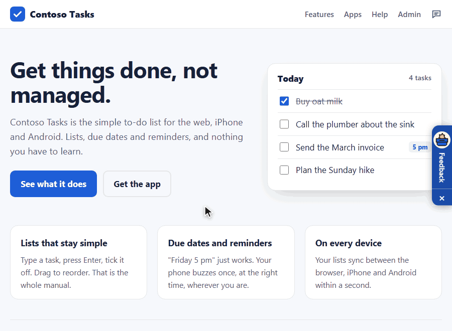
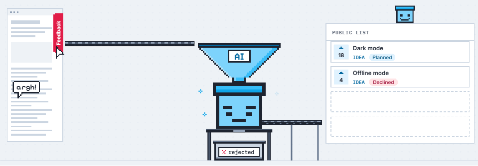
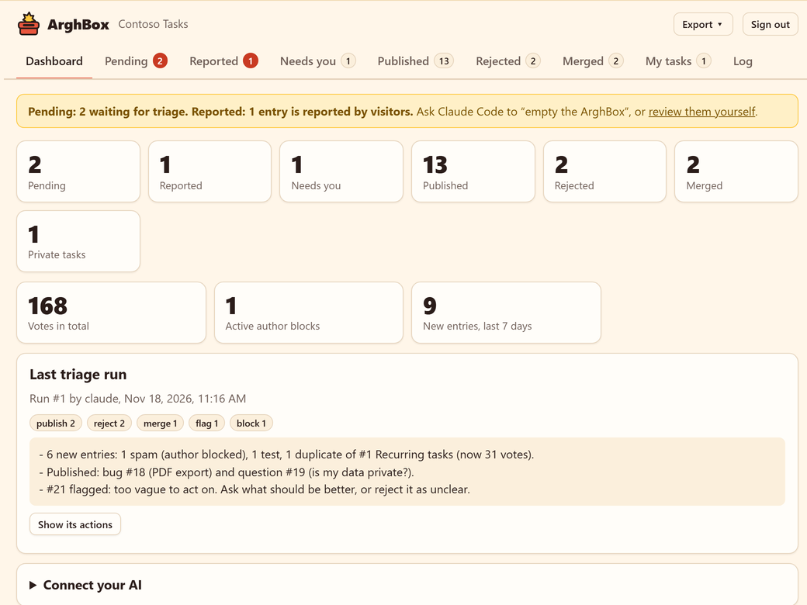
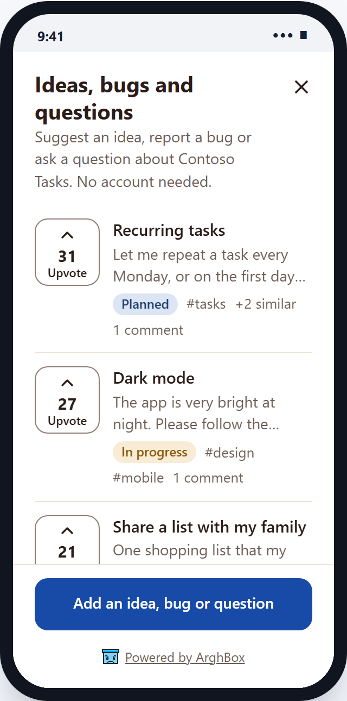

<div align="center">

<picture>
  <source media="(prefers-color-scheme: dark)" srcset="art/logo-horizontal-dark.png">
  
</picture>

<h1>Free user feedback for your website and app,<br>sorted by your AI.</h1>

<p><b>ArghBox</b> adds a <b>Feedback</b> tab to your website or app. Visitors post ideas and bugs and upvote the best ones, with no sign-up. Your AI (Claude Code or Codex) clears out the spam and duplicates. It runs free on the PHP hosting your site already has, and it's open source.</p>

<p>
  <a href="https://binarybananallc.github.io/ArghBox/"></a>
</p>

<p><a href="#install">Install</a> · <a href="#how-the-ai-part-works">How the AI part works</a> · <a href="docs/install.md">Docs</a></p>

<a href="https://binarybananallc.github.io/ArghBox/"></a>

</div>

## Why ArghBox?

Most feedback tools cost a monthly fee, need a server of their own, or make visitors sign up. ArghBox does none of that.

- **Free and open source.** MIT. Every feature is free when you host it, and there's no AI bill.
- **Free to host.** It runs on the PHP hosting your website already has. Upload one folder: no Docker, no database server.
- **No sign-up for visitors.** One click to vote. Cloudflare Turnstile keeps bots out.
- **Your AI sorts the pile.** Claude Code or Codex rejects spam, merges duplicates and flags what needs you. Rather do it by hand? Click Publish on the admin page.

No other feedback widget does all four.

### How the AI part works



Open Claude Code or Codex in your site's folder and say:

```
Empty the ArghBox
```

This is a real run on a box with 31 new entries ([full log](tests/fixtures/box-30.sample-run.md)):

> Emptied the box: 31 new entries handled.
> - 11 published (5 of them bugs), 12 rejected (6 spam, 1 prompt-injection attempt, 2 test posts, 1 insult, 1 off-topic, 1 too vague), 5 merged, 3 flagged.
> - Needs you: #34 XSS report in the place search (do not publish), #35 contains an email address, #45 GDPR deletion request.

- It runs on your computer with the Claude or ChatGPT plan you already have. Your server never calls an AI.
- It follows `RULES.md`, plain Markdown you can edit. When it isn't sure, it leaves the entry for you.
- Every run is logged on the admin page, and one command undoes it.

**Admin page example** from the [live demo](https://binarybananallc.github.io/ArghBox/arghbox/admin/) (password `demo`), after an AI run:

<picture>
  <source media="(prefers-color-scheme: dark)" srcset="docs/images/admin-run-dark.png">
  
</picture>

## Install

About 10 minutes. You need web hosting with PHP 8.1 or newer (almost every shared host has it), a free [Cloudflare Turnstile](https://dash.cloudflare.com/?to=/:account/turnstile) key (your domain doesn't have to be on Cloudflare) and [Node.js](https://nodejs.org) 22+ on your computer for the setup commands. Node never runs on the server.

1. **Add ArghBox to your site.** In your site's folder:

   ```
   npm install --save-dev arghbox
   npx arghbox install
   ```

   It finds your web root (`public`, `public_html`, ...), copies the `arghbox` server folder into it and adds the AI skill for Claude Code and Codex. Wrong folder? Add `--public <folder>`.

   **Not using npm in your site?** Download the zip from the [latest release](https://github.com/BinaryBananaLLC/ArghBox/releases) and upload its `arghbox` folder by FTP.

2. **Write the config.** Run `npx arghbox secrets` and save the two tokens it prints in your password manager (they are shown once). Copy `arghbox/config.example.php` to `config.php` and fill in your site's address, your Turnstile keys and the printed lines. Upload it to the server into a folder named `arghbox-private` next to your web root, not inside it, and never commit it. [Details](docs/install.md#3-decide-where-configphp-and-the-data-go)

3. **Add one line to your pages, then deploy:**

   ```html
   <script src="/arghbox/arghbox.js?v=0.1.2" defer></script>
   ```

That's it. The Feedback tab is live. To let your AI empty the box, see [docs/triage.md](docs/triage.md).

**Or let your AI install it.** Open Claude Code or Codex in your site's folder and say:

```
Add ArghBox to this site: https://github.com/BinaryBananaLLC/ArghBox
```

It runs the steps above and asks you for your site's address and Turnstile keys. You save the tokens, upload `config.php` and deploy.

The [full install guide](docs/install.md) covers hosting specifics, Cloudflare and troubleshooting.

<details>
<summary><b>Update automatically on every build</b></summary>

If your site has a build step, let it copy ArghBox each time and git-ignore the copies (`public/arghbox/`, `.claude/skills/arghbox-triage/` and `.agents/skills/arghbox-triage/`). Your `config.php` and data are never touched.

```json
"scripts": {
  "predev": "arghbox install --quiet",
  "prebuild": "arghbox install --quiet"
}
```

Upgrading is then `npm install --save-dev arghbox@latest`. For the `?v=` in the script tag, `import { version } from 'arghbox'` gives the installed version.

</details>

## What else is in the box

- **Public roadmap and changelog.** Post your own plans next to visitor requests. Mark them Planned, In progress or Done.
- **Ask your box questions.** Connect it to Claude Code, Cursor or VS Code ([MCP](docs/mcp.md)) and ask "what are people asking about exports?"
- **Your data stays yours.** One SQLite file. Export to JSON, CSV or Jira any time, or follow the Atom feed in Slack. [More](docs/integrations.md)
- **Private by design.** No cookies, no emails, no raw IP addresses stored.
- **Fits your site.** Under 4 KB to load. Light and dark themes, your colours, full screen on phones, works with a keyboard and screen readers. [Options](docs/configuration.md)
- **Moderation tools.** A Report button on every entry, auto-hide after 3 reports, block an author, undo anything.

### In your mobile app too

Show the same board inside your iOS, Android, React Native or Flutter app with a WebView. No sign-in and no native screens to build. Votes from the app and the website land in one box. [Mobile guide](docs/mobile.md) · [Try it in the demo](https://binarybananallc.github.io/ArghBox/#apps)

<p align="center">
  <a href="https://binarybananallc.github.io/ArghBox/#apps">
    <picture>
      <source media="(prefers-color-scheme: dark)" srcset="docs/images/mobile-app-dark.png">
      
    </picture>
  </a>
</p>

## FAQ

<details>
<summary><b>Do I need Claude Code?</b></summary>

No. Codex does the same job. With no AI at all, you publish new entries yourself on the admin page, or set `moderation` to `'publish'` so they show at once.

</details>

<details>
<summary><b>What does it cost?</b></summary>

Nothing to host it yourself. ArghBox is MIT-licensed, every feature is free, and it never calls a paid AI. Turnstile is free. Triage runs in your own Claude Code or Codex session, so it uses your plan like any other task.

</details>

<details>
<summary><b>Will it work on my site?</b></summary>

If your host runs PHP 8.1 or newer, yes: WordPress, a static site generator or plain HTML.

**No PHP?** We're thinking about hosting ArghBox for you, with a free tier for small sites, so all you add is the script tag. If you'd use it, [tell us on the Feedback tab at ArghBox.com](https://arghbox.com/#arghbox). If enough people ask, we'll build it.

</details>

<details>
<summary><b>Does it slow my pages down?</b></summary>

No. The loader is under 4 KB gzipped and loads nothing else until someone opens the tab.

</details>

<details>
<summary><b>What about GDPR?</b></summary>

ArghBox stores no cookies, no emails and no raw IP addresses, and the form shows visitors exactly what is sent. This is not legal advice, so check your own obligations.

</details>

<details>
<summary><b>Is it secure?</b></summary>

The admin page and the AI use separate tokens, stored only as hashes. Visitor text is always shown as text, never as HTML, and the AI treats it as untrusted data, so prompt-injection attempts get rejected. Turnstile and rate limits guard the public form. Found a vulnerability? Please report it privately ([SECURITY.md](SECURITY.md)).

</details>

<details>
<summary><b>Is it ready to use? Who maintains it?</b></summary>

Yes. BinaryBanana LLC built ArghBox for its own websites and apps and uses it on them every day, including [ArghBox.com](https://arghbox.com). We need it for our own products, so we keep maintaining it, and we build it in public.

The first release came out in November 2026. It has unit and end-to-end tests, and each npm release carries a provenance attestation. If something breaks, please [open an issue](https://github.com/BinaryBananaLLC/ArghBox/issues/new/choose).

</details>

<details>
<summary><b>What isn't supported yet?</b></summary>

- More than one admin login, with roles for a team
- Email updates for voters when their idea ships
- Several boards for different products in one install
- Webhooks, and importing from other feedback tools
- Hosting without PHP (see "Will it work on my site?")

Need one of these? Tell us what's missing on the [Feedback tab at ArghBox.com](https://arghbox.com/#arghbox), and we'll be happy to look into it. Or build it with us: ArghBox is open source, and [pull requests are welcome](CONTRIBUTING.md).

</details>

## Contributing

- **Bugs, ideas and questions:** open a [GitHub issue](https://github.com/BinaryBananaLLC/ArghBox/issues/new/choose), or use the Feedback tab on [ArghBox.com](https://arghbox.com/#arghbox), where other people can vote for them.
- **Security problems:** please report them privately, see [SECURITY.md](SECURITY.md).
- **Pull requests** are welcome. See [CONTRIBUTING.md](CONTRIBUTING.md) and the [Code of Conduct](CODE_OF_CONDUCT.md).

ArghBox is free. If it saves you time, you can [buy the project a coffee](https://arghbox.com/donate/).

## Licence

[MIT](LICENSE). The fonts in `art/` keep their SIL OFL licence. The name and logo are trademarks of BinaryBanana LLC: fork freely, but give a changed version its own name ([TRADEMARKS.md](TRADEMARKS.md)).
