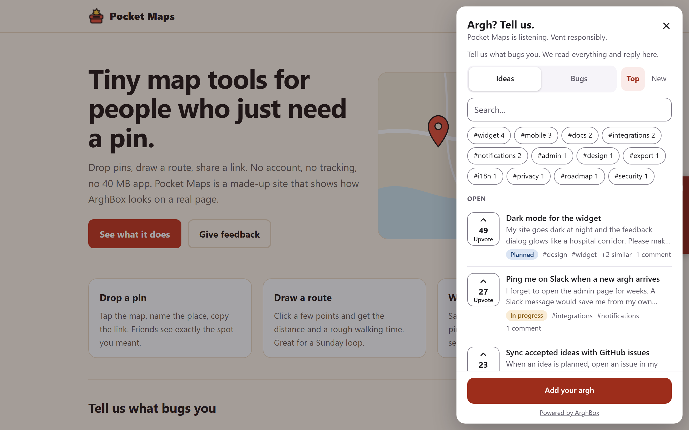
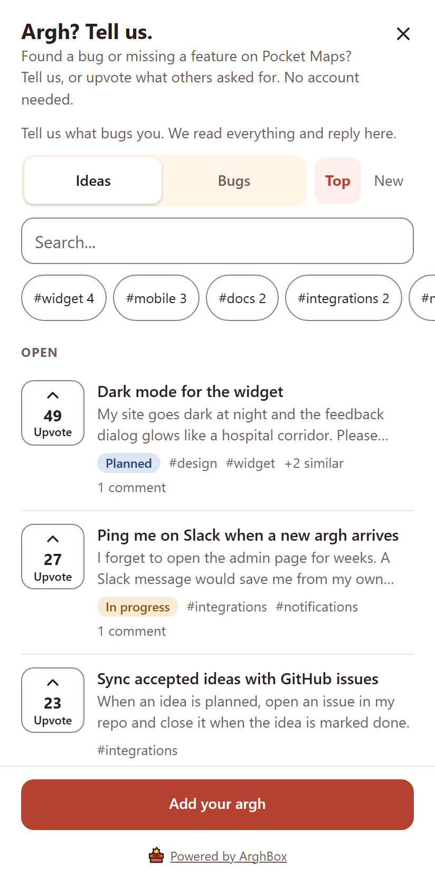
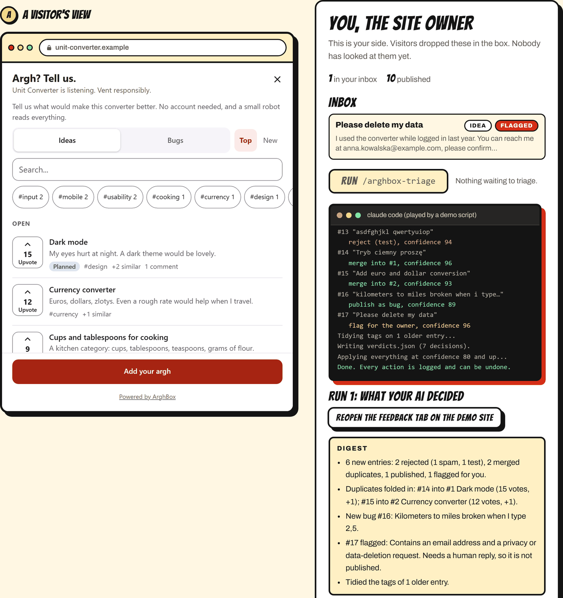
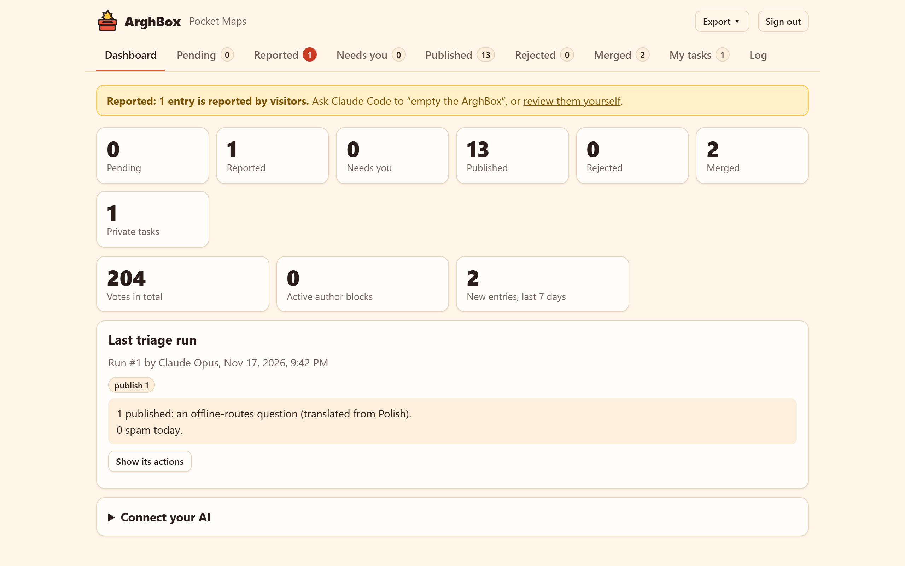
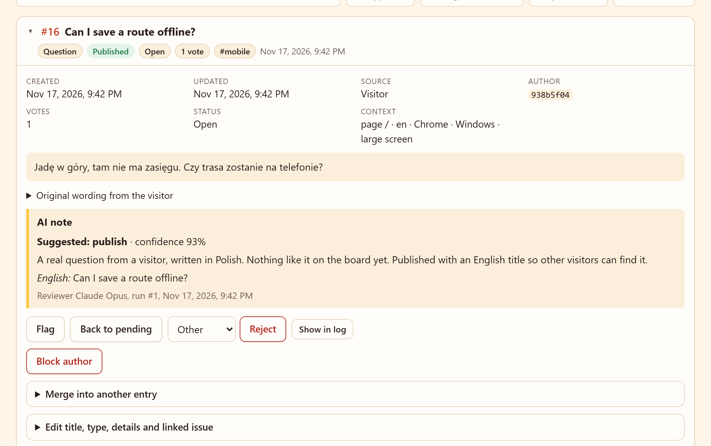

<div align="center">


### A feedback tab for your website. Visitors vote without an account. Your own AI does the moderating.

**The only feedback widget with all of it:** one PHP folder, no database server, no email, no visitor accounts, AI triage with no AI bill, MIT.

**[▶ Try the live demo](https://arghbox.com/demo/)** · [Install in 10 minutes](#install-in-10-minutes) · [Why ArghBox](#why-arghbox) · [Docs](docs/install.md)

[](https://www.npmjs.com/package/arghbox)
[](LICENSE)
[](docs/install.md)
[](docs/triage.md)

</div>

## What it is

ArghBox™ puts a **Feedback** tab on the edge of your pages. Visitors open it, upvote the ideas and bugs other people already posted, or add their own. They don't sign in.

You don't sort the pile. Tell Claude Code **"Empty the ArghBox"**: it rejects the spam, merges duplicates with their votes, tags the rest and lists the few entries that need you.

It is also your public roadmap and changelog. Visitor requests and your own items sit in one list, and you decide which of yours are public. Mark something Planned, In progress or Done, and the list and its feed update.

The server side is one PHP folder with a SQLite file. It runs on the cheap shared hosting your site already uses.

<table>
  <tr>
    <td width="40%"></td>
    <td width="40%"></td>
    <td width="20%"></td>
  </tr>
  <tr>
    <td align="center"><sub>Vote, search, filter</sub></td>
    <td align="center"><sub>Light and dark themes</sub></td>
    <td align="center"><sub>Full-screen on phones</sub></td>
  </tr>
</table>

## See it work

[](https://arghbox.com/demo/)

**[arghbox.com/demo](https://arghbox.com/demo/)**: be a visitor on a made-up site and add an argh. Then switch sides, run the triage, and watch spam disappear and duplicates merge. Everything runs in your browser. There is nothing to install, and nothing you type leaves the page.

- **A real box:** the Feedback tab on [arghbox.com](https://arghbox.com) is a live ArghBox. The project collects its own ideas there.
- **On your machine:** clone this repository and run `npm run dev` (needs PHP 8.1+ and Node.js 22+). It serves the [demo site](demo/) at `http://localhost:8787` with a seeded box, the admin page and a fake Turnstile.

## Why ArghBox

**No other feedback tool does all five.** ArghBox is built for small sites that can't run Docker and don't want another subscription.

- **Your AI does the moderating, at no extra cost.** Most boards leave you to moderate by hand, or sell AI as a paid add-on. ArghBox comes with a Claude Code skill that rejects spam, merges duplicates with their votes, tags entries and flags what needs a human. It uses the Claude plan you already have, and the server never calls an AI. Every run is logged and can be undone.
- **Nothing to run but a folder.** No Docker, no database server, no email provider. PHP 8.1 and SQLite on a few-dollars-a-month shared host. Upload a folder, add one script tag.
- **No accounts, and still no spam.** Visitors vote and post without signing in or leaving an email. Cloudflare Turnstile, rate limits and a review queue keep bots off the public list.
- **A tab on your pages, not another website.** Static site generator, WordPress or hand-written HTML: if your host runs PHP, one script tag adds the tab. The loader is under 4 KB gzipped and lives in a Shadow DOM, so your CSS can't break it.
- **Free, MIT, and your data stays yours.** There is no paid tier. Everything is one SQLite file that you can export to JSON, CSV or a Jira import CSV at any time.

### How it compares

| | **ArghBox** | Hosted feedback services | Self-hosted boards (Fider, LogChimp) |
|---|---|---|---|
| Cost for a small site | **Free** | Free tier with limits, then a monthly plan | Free, plus a server to run it on |
| What you run | **One PHP folder on shared hosting** | Nothing, it's hosted | A server with PostgreSQL (usually in Docker), often an email service |
| Visitors need an account | **No** | Depends on the service; some ask for a name and email | Yes |
| AI moderation | **Your own Claude Code, no extra bill** | Often part of a paid plan | Not built in |
| On your own pages | **One script tag** | A widget | A separate portal site |
| Licence | **MIT** | Proprietary | AGPL-3.0 |

<sub>As of November 2026, from each project's public documentation. Need accounts, roles or several boards? See [Is ArghBox for you?](#is-arghbox-for-you)</sub>

## How it works


1. A visitor opens the Feedback tab, votes, or adds an idea. New entries wait for review.
2. You say "Empty the ArghBox" in Claude Code. It judges the waiting entries by written rules and applies its verdicts in one checked transaction.
3. Visitors see a clean, deduplicated list. You get a short report and can undo anything.

## Install in 10 minutes

You need PHP 8.1+ with SQLite on the web host. On your own computer you need [Node.js](https://nodejs.org) 22+ for the helper commands and the triage skill. Node never runs on the server.

1. **Get a Turnstile key.** Make a free [Cloudflare Turnstile](https://dash.cloudflare.com/?to=/:account/turnstile) widget. Your domain doesn't have to be on Cloudflare.
2. **Add ArghBox to your site's repository** and copy it into your web root (`public`, `public_html`, `src/public` or `.`):

   ```
   npm install --save-dev arghbox
   npx arghbox install --public public --skill
   ```

   This puts the server folder in `public/arghbox/` and the triage skill in `.claude/skills/arghbox-triage/`.
3. **Write the config.** Run `npx arghbox secrets`, then fill in `config.php` from `arghbox/config.example.php`. On the server it goes in an `arghbox-private` folder next to `public_html`.
4. **Deploy** as usual, or upload the `arghbox/` folder by FTP. Open `/arghbox/api.php?action=health` and check that `config` is `"found"`, `config_valid` is `true` and `sqlite` shows a version.
5. **Add one line to your pages:**

   ```html
   <script src="/arghbox/arghbox.js?v=0.1.0" defer></script>
   ```

The full walkthrough, with hosting specifics, Cloudflare notes and troubleshooting, is in **[docs/install.md](docs/install.md)**.

<details>
<summary><b>Keep it updated automatically</b></summary>

If your site has a build step, let it copy ArghBox on every build and git-ignore the copies (`public/arghbox/` and `.claude/skills/arghbox-triage/`). Your `config.php` and data are never touched:

```json
"scripts": {
  "predev": "arghbox install --public public --skill --quiet",
  "prebuild": "arghbox install --public public --skill --quiet"
}
```

Upgrading is then `npm install --save-dev arghbox@latest` (or a Dependabot pull request). For the `?v=` of the script tag, `import { version } from 'arghbox'` in your build config gives the installed version.

</details>

<details>
<summary><b>No Node.js? Use the zip</b></summary>

Download `arghbox-<version>.zip` from the [releases](https://github.com/BinaryBananaLLC/ArghBox/releases) and upload its `arghbox` folder. Every release file and the npm package carry a provenance attestation that ties them to this repository's release workflow.

</details>

## Let your AI empty the box

With the skill in your repository (step 2) and the triage token saved in `.arghbox/token`, open Claude Code and say:

> Empty the ArghBox.

Claude Code fetches what is waiting and judges each entry by the rules in `RULES.md`, which is plain Markdown you can edit. It applies the confident verdicts and leaves the rest for you. This is a real run on a box with 31 waiting entries ([full log](tests/fixtures/box-30.sample-run.md)):

> Emptied the box: 31 new entries handled.
> - 11 published (5 of them bugs), 12 rejected (6 spam including a 3-post burst from one source, 1 prompt-injection attempt, 2 test posts, 1 insult, 1 off-topic, 1 too vague), 5 merged, 3 flagged.
> - Duplicates merged with their votes: night mode into #1 (now 18 votes), the Polish KML-styles request into #2, the German batch-convert request into #10 ...
> - Needs you: #34 XSS report in the place search (do not publish), #35 contains an email address, #45 GDPR deletion request.

Everything is logged on the admin page, and `triage.mjs undo --run <id>` takes a whole run back. Codex and other coding agents can follow the same instructions. More in **[docs/triage.md](docs/triage.md)**.

<table>
  <tr>
    <td width="50%"></td>
    <td width="50%"></td>
  </tr>
  <tr>
    <td align="center"><sub>The admin page after a triage run</sub></td>
    <td align="center"><sub>Each AI verdict shows its reason and confidence</sub></td>
  </tr>
</table>

## More ways to use it

| | |
|---|---|
| **Mobile apps** | Show the board in a WebView in your iOS, Android, React Native or Flutter app, with no sign-in. The Report and Block author features cover what app stores ask of apps with user posts. **[docs/mobile.md](docs/mobile.md)** |
| **MCP server** | Connect the box to Claude Code, Cursor or VS Code, then ask "what are people asking about exports?" or "mark #12 done and thank the visitor". **[docs/mcp.md](docs/mcp.md)** |
| **Export and integrations** | JSON, CSV, a Jira import CSV, an Atom feed for Slack or Zapier, and links from entries to Jira, GitHub or Linear issues. **[docs/integrations.md](docs/integrations.md)** |
| **Configuration** | One `config.php` and a few script-tag attributes: position, theme, accent colour, language, tone. **[docs/configuration.md](docs/configuration.md)** · [HTTP API](docs/api.md) |

<details>
<summary><b>All features</b></summary>

**For visitors**
- A small tab on the page edge, a full-screen sheet on phones, light and dark themes
- A public list of ideas and bugs with votes, search, tag filters, statuses and the owner's replies
- Adding an idea first shows similar entries ("Is it one of these? Vote instead"), so duplicates are rare
- "Your arghs": visitors see what happened to their own entries, even why one was not published
- A **Report** button on every entry: three reports from different people hide it until you review it
- Keyboard friendly, screen-reader friendly, funny or neutral wording, translatable

**For owners**
- An admin page for statuses, public comments and private notes
- **Roadmap:** your own items next to visitor requests. Keep an item private as a to-do, or make it public and visitors see it marked "From the team"
- **Changelog:** set an item to Planned, In progress, Done or Declined. Done items move to the Closed list with their date, and the Atom feed reports them as "[Done]"
- A **Reported** list with "Keep it" or "Put it back", a blocked-authors list and **Block author**
- Every change is logged and can be undone, one action or a whole triage run

**AI triage**
- A Claude Code skill empties the box: it rejects spam, merges duplicates (with their votes), tags and flags
- The AI suggests, you decide: low-confidence verdicts wait for you
- Reported entries get a keep or reject decision too, and the AI may block a clear spam author
- Visitor text is treated as untrusted data, so prompt-injection attempts are rejected

**MCP**
- `mcp.php` lets Claude Code, Cursor and VS Code search and update the box conversationally
- A read-only token for "what are users asking about?" sessions
- No delete tool, and public writes are off by default

**Data and export**
- JSON (everything), CSV (for spreadsheets) and Jira CSV (ready to import)
- Link entries to Jira, GitHub or Linear issues with `external_url`

</details>

## Privacy and security

- **No cookies, no emails, no raw IPs.** Votes are tied to a random key in the visitor's browser. IP addresses become a keyed hash, used only for rate limits and spotting bursts.
- **Visitors see what is sent.** Entries record the page path, browser family, operating system and a screen-size class, and the add form shows exactly that. If your URLs contain secrets, [replace the recorded path](docs/configuration.md#keeping-secrets-out-of-the-recorded-page).
- **One third party, only when needed.** Cloudflare Turnstile loads when the dialog opens, not before.
- **Safe by design.** Visitor text is always rendered as text, never as HTML, and the triage AI treats it as untrusted data. Admin and triage tokens are stored only as hashes.
- Found a vulnerability? Please report it privately, see [SECURITY.md](SECURITY.md).

## Is ArghBox for you?

**A good fit** if you run a small site or side project on ordinary PHP hosting, you want feedback without making visitors create an account, and you'd rather your own AI sort the pile than moderate it yourself.

**Probably not** if you need user accounts and roles, email notifications to voters, several boards for different products, or a hosted service with an SLA. A full feedback portal will suit you better; [Fider](https://fider.io) and [LogChimp](https://logchimp.codecarrot.net) are open-source options worth a look.

## FAQ

<details>
<summary><b>Do visitors need an account?</b></summary>

No. A Turnstile check, usually invisible, stands in for a login.

</details>

<details>
<summary><b>What does the AI cost?</b></summary>

Nothing extra. Triage runs in your own Claude Code session, on the plan you already pay for. ArghBox never calls a paid AI API.

</details>

<details>
<summary><b>Can I use Codex or another agent?</b></summary>

Yes. The skill is plain Markdown instructions plus a Node script, so any coding agent that can read the instructions and run `node` can follow them. See [docs/triage.md](docs/triage.md).

</details>

<details>
<summary><b>What about GDPR?</b></summary>

ArghBox stores no raw IPs, no emails and no visitor cookies, and it shows what it sends. You decide the retention: entries can be exported and removed from the SQLite file. This is not legal advice, so check your own obligations.

</details>

<details>
<summary><b>Does it slow my site down?</b></summary>

No. The loader is under 4 KB gzipped, deferred, and makes no network request until a visitor interacts with the tab. The dialog code loads on first intent.

</details>

<details>
<summary><b>Can it run on purely static hosting?</b></summary>

Not yet, because it needs PHP. A Cloudflare Worker and D1 backend is a v2 idea.

</details>

## Roadmap

Ideas for v2, in no strict order: webhooks, importers from other tools, a column view of the roadmap and a changelog page, OAuth for MCP so claude.ai can connect, more languages, and a Cloudflare Worker and D1 backend. Vote on them, or add yours, on the board at [arghbox.com](https://arghbox.com).

## Contributing and support

- **Bugs:** [GitHub issues](https://github.com/BinaryBananaLLC/ArghBox/issues/new/choose).
- **Ideas and questions:** the Feedback tab on [arghbox.com](https://arghbox.com/), where ArghBox collects its own feedback.
- **Pull requests** are welcome, see [CONTRIBUTING.md](CONTRIBUTING.md). Before a large change, please post the idea on the board first. Everyone taking part follows the [Code of Conduct](CODE_OF_CONDUCT.md).

ArghBox is free and always will be. If it saves you time, you can [chip in a coffee](https://arghbox.com/donate/). It helps keep the project going, and it is never expected.

## Licence

[MIT](LICENSE). The lettering fonts keep their own SIL OFL licence, see [art/README.md](art/README.md).

ArghBox™ and the ArghBox logo are trademarks of BinaryBanana LLC. The MIT licence covers the code, not the name. Run it, change it and fork it freely, but give a changed version that you publish its own name. [TRADEMARKS.md](TRADEMARKS.md) says what is fine without asking.

ArghBox is not affiliated with any other product named here.
