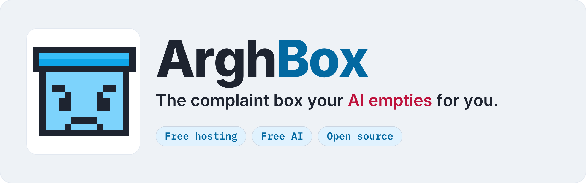
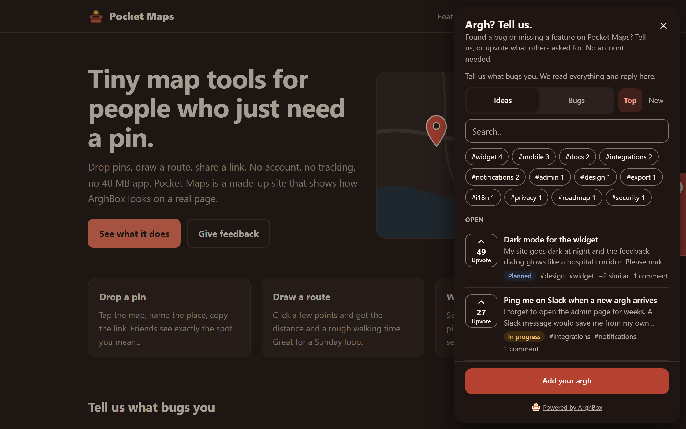
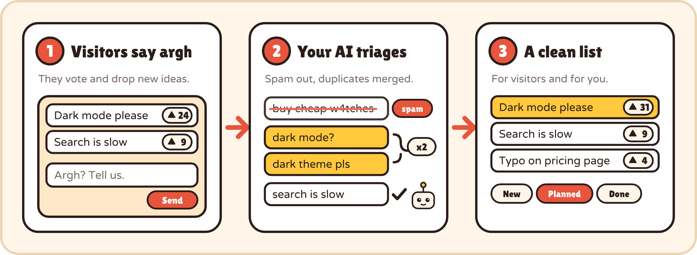

<div align="center">



**The complaint box your AI empties for you.**

[](https://www.npmjs.com/package/arghbox)
[](LICENSE)
[](docs/install.md)
[](#why-arghbox)
[](docs/triage.md)
[](https://arghbox.com/donate/)

**Try it live on [arghbox.com](https://arghbox.com): click the Feedback tab.**

</div>

ArghBox™ is an open-source feedback widget for small websites. Visitors click a **Feedback** tab on the edge of the page, upvote the ideas and bugs other people already posted, or add their own, with no sign-in. Spam is stopped by Cloudflare Turnstile. The backend is PHP and SQLite in one folder that you upload to ordinary shared hosting. And you never sort the pile by hand: a skill for your own [Claude Code](https://claude.com/claude-code) rejects spam, merges duplicates, tags the rest and tells you what needs you. ArghBox itself makes no paid AI calls.

<table>
  <tr>
    <td width="40%"></td>
    <td width="40%"></td>
    <td width="20%"></td>
  </tr>
  <tr>
    <td align="center"><sub>The public list: vote, search, filter</sub></td>
    <td align="center"><sub>Follows light and dark themes</sub></td>
    <td align="center"><sub>Full-screen on phones</sub></td>
  </tr>
</table>

## Why ArghBox

- **No Docker, no database server.** PHP 8.1+ and SQLite. Upload a folder, add one script tag.
- **No accounts.** Visitors do not sign in, and you do not manage users. Turnstile keeps the bots out.
- **No email.** There is nothing to send, so there is no mail provider to set up.
- **No AI bill.** Your own Claude Code does the judging, with the subscription you already have. Codex and similar agents can follow the same instructions.
- **Cheap hosting is enough.** It was built for the kind of shared hosting that costs a few dollars a month.
- **Your data stays yours.** One SQLite file, and exports to JSON, CSV and a Jira-ready CSV at any time.

## Features

**For visitors**
- A small tab on the page edge, a full-screen sheet on phones, light and dark themes
- A public list of ideas and bugs with votes, search, tag filters, statuses and the owner's replies
- Adding an idea first shows similar entries ("Is it one of these? Vote instead"), so duplicates are rare
- "Your arghs": visitors see what happened to their own entries, even why one was not published
- A **Report** button on every entry: three reports from different people hide it until you review it
- Keyboard friendly, screen-reader friendly, funny or neutral wording, translatable

**For owners**
- An admin page for statuses, public comments and private notes
- Private to-do items that never show up on the public list
- A **Reported** list with "Keep it" or "Put it back", a blocked-authors list and **Block author**, so you can show the box inside an app store app
- Every change is logged and can be undone, one action or a whole triage run
- An Atom feed of the backlog and changelog

**AI triage**
- A Claude Code skill empties the box: it rejects spam, merges duplicates (with their votes), tags and flags
- The AI suggests, you decide: low-confidence verdicts wait for you
- Reported entries get a keep or reject decision too, and the AI may block a clear spam author
- Visitor text is treated as untrusted data, so prompt-injection attempts are rejected

**MCP**
- `mcp.php` lets Claude Code, Cursor and VS Code search and update the box conversationally
- A read-only token for "what are users asking about?" sessions
- No delete tool, and public writes are off by default

**Data and export**
- JSON (everything), CSV (for spreadsheets) and Jira CSV (ready to import)
- Link entries to Jira, GitHub or Linear issues with `external_url`

**Privacy**
- No cookies for visitors, no raw IP addresses stored, no emails
- The only third-party request is Cloudflare Turnstile, and only when the dialog opens

## How it works



1. A visitor opens the Feedback tab, votes, or adds an idea. New entries wait for review.
2. You tell Claude Code "empty the ArghBox". It fetches the waiting entries, judges them by written rules, and applies the verdicts through one checked transaction.
3. Visitors see a clean, deduplicated list. You get a short report, and can undo anything.

## Quick start (about 10 minutes)

You need PHP 8.1+ with SQLite on the web host, and [Node.js](https://nodejs.org) 22 or newer on
your own computer for the helper tools and the triage skill. Node never runs on the server.

1. Make a free [Cloudflare Turnstile](https://dash.cloudflare.com/?to=/:account/turnstile) widget. Your domain does not have to be on Cloudflare.
2. In your site's repository, add ArghBox and copy it into your web root folder (`public`, `public_html`, `src/public` or `.`, whatever your site serves):

   ```
   npm install --save-dev arghbox
   npx arghbox install --public public --skill
   ```

   That puts the `arghbox/` server folder in `public/arghbox/` and the triage skill in `.claude/skills/arghbox-triage/`.
3. Run `npx arghbox secrets` and write `config.php` from `arghbox/config.example.php`. On the server it goes in an `arghbox-private` folder next to `public_html`.
4. Deploy your site as usual (or upload the `arghbox/` folder with File Manager or FTP), then open `/arghbox/api.php?action=health` and check that `config` is `"found"`, `config_valid` is `true` and `sqlite` shows a version.
5. Add the script tag to your pages:

```html
<script src="/arghbox/arghbox.js?v=0.1.0" defer></script>
```

The full walkthrough, with Hostinger specifics, Cloudflare notes and troubleshooting, is in **[docs/install.md](docs/install.md)**. To try everything on your own machine first, clone this repository and run `npm run dev`: it starts the demo site, a fake Turnstile and a seeded box.

**Keep it updated by itself.** If your site has a build step, let it copy ArghBox on every build and git-ignore the copies (`public/arghbox/` and `.claude/skills/arghbox-triage/`). Your `config.php` and data are never touched:

```json
"scripts": {
  "predev": "arghbox install --public public --skill --quiet",
  "prebuild": "arghbox install --public public --skill --quiet"
}
```

Upgrading is then `npm install --save-dev arghbox@latest` (or a Dependabot pull request). For the `?v=` of the script tag, `import { version } from 'arghbox'` in your build config gives the installed version.

**No Node.js?** Download `arghbox-<version>.zip` from the [releases](https://github.com/BinaryBananaLLC/ArghBox/releases) and upload its `arghbox` folder. Every release file and the npm package carry a provenance attestation that ties them to this repository's release workflow.

## The triage skill

Copy the skill into your site's repository (`npx arghbox install --skill-only` does it, or `--skill` together with the server folder), save the triage token in `.arghbox/token` and say:

> Empty the ArghBox.

Claude Code fetches what is waiting, applies the rules in `RULES.md` and writes a report. This is a real run on a box with 31 waiting entries (see [`tests/fixtures/box-30.sample-run.md`](tests/fixtures/box-30.sample-run.md)):

> Emptied the box: 31 new entries handled.
> - 11 published (5 of them bugs), 12 rejected (6 spam including a 3-post burst from one source, 1 prompt-injection attempt, 2 test posts, 1 insult, 1 off-topic, 1 too vague), 5 merged, 3 flagged.
> - Duplicates merged with their votes: night mode into #1 (now 18 votes), the Polish KML-styles request into #2, the German batch-convert request into #10 ...
> - Needs you: #34 XSS report in the place search (do not publish), #35 contains an email address, #45 GDPR deletion request.

Everything is logged on the admin page, and `triage.mjs undo --run <id>` takes a whole run back. More in **[docs/triage.md](docs/triage.md)**.

<table>
  <tr>
    <td width="50%"></td>
    <td width="50%"></td>
  </tr>
</table>

## Mobile apps

Your iOS, Android, React Native or Flutter app can show the whole board in a WebView with no sign-in: open `https://example.com/arghbox/app.html?platform=ios&version=2.3.1`. The page tells your app when the visitor closes it, and the new Report and Block author features, plus a `contact_url`, cover what the App Store and Google Play ask of apps with user posts. Copy-paste code for Swift, Kotlin, React Native and Flutter is in **[docs/mobile.md](docs/mobile.md)**.

## MCP

Connect Claude Code to your box in one line (the triage command `node .claude/skills/arghbox-triage/triage.mjs mcp-config` prints it for your site):

```
claude mcp add --transport http arghbox https://example.com/arghbox/mcp.php --header "Authorization: Bearer <YOUR_TRIAGE_TOKEN>"
```

Then ask things like "what are people asking about exports?" or "mark #12 done and thank the visitor". Cursor and VS Code work too. Setup, the tools list and the safety notes are in **[docs/mcp.md](docs/mcp.md)**.

## Export and integrations

- **Jira CSV**: published open, planned and in-progress entries with Jira's import columns.
- **Atom feed**: `/arghbox/api.php?action=feed`, for feed readers, Slack or Zapier.
- **JSON**: everything, for moving to another tool.
- **The AI recipe**: ask Claude Code, with the Atlassian or GitHub MCP server connected, to create an issue for each planned entry and store its link in the entry's `external_url`. Visitors never see that link; you see it on the admin page.

Details in **[docs/integrations.md](docs/integrations.md)**.

## Configuration

One `config.php` with a handful of keys (site name, Turnstile keys, tokens, moderation mode, tags, limits), and a few optional attributes on the script tag (position, theme, accent colour, language, tone). Every option is listed in **[docs/configuration.md](docs/configuration.md)**. The HTTP API is documented in [docs/api.md](docs/api.md).

## Privacy and security

- Visitors get no cookies. Their votes are tied to a random key in their own browser.
- IP addresses are never stored raw: they become a keyed hash, used only for rate limits and spotting bursts.
- Entries record the page path, the browser family, the operating system and a screen-size class, and the add form shows exactly that before sending. If your URL paths contain secrets (reset tokens, magic links), replace the recorded path with the `data-page` attribute or a `window.ArghBoxConfig.redactPage` function, see [docs/configuration.md](docs/configuration.md#keeping-secrets-out-of-the-recorded-page).
- The widget lives in a Shadow DOM and cannot be styled or broken by the host page.
- Admin and triage tokens are stored only as hashes. Visitor text is always rendered as text, never as HTML, and the triage AI is told to treat it as untrusted data.
- Found a vulnerability? Please report it privately, see [SECURITY.md](SECURITY.md).

## Is ArghBox for you?

**A good fit** if you run a small site or side project, you're on ordinary PHP hosting, you want
visitors to give feedback without creating an account, and you'd rather have your own AI sort
the pile than moderate it yourself.

**Probably not** if you need user accounts and roles, email notifications to voters, several
boards for different products, or a hosted service with an SLA. A full feedback portal will
suit you better; [Fider](https://fider.io) and [LogChimp](https://logchimp.codecarrot.net) are
open-source options worth a look.

## FAQ

**Do visitors need an account?** No. A Turnstile check, usually invisible, stands in for a login.

**What does the AI cost?** Nothing extra. Triage runs in your own Claude Code session, using the plan you already pay for. ArghBox never calls a paid AI API.

**Can I use Codex?** Yes. The skill is plain Markdown instructions plus a Node script, so any coding agent that can read the instructions and run `node` can follow them. See [docs/triage.md](docs/triage.md).

**What about GDPR?** ArghBox stores no raw IPs, no emails and no cookies for visitors, and shows what it sends. You decide the retention: entries can be exported and removed from the SQLite file. This is not legal advice, so check your own obligations.

**Does it slow my site?** The loader is under 4 KB gzipped, deferred, and makes no network request until a visitor interacts with the tab. The dialog code loads on first intent.

**Pure static hosting?** Not yet: it needs PHP. A Worker and D1 backend is a v2 idea.

## Roadmap

Ideas for v2, in no strict order: webhooks, importers from other tools, a roadmap view, OAuth for MCP so claude.ai can connect, more languages, and a Cloudflare Worker and D1 backend. Vote and add yours on the board at [arghbox.com](https://arghbox.com).

## Contributing and support

Report bugs as [GitHub issues](https://github.com/BinaryBananaLLC/ArghBox/issues/new/choose). Ideas and questions go to the Feedback tab on [arghbox.com](https://arghbox.com/), where ArghBox collects its own feedback. Pull requests are welcome here, see [CONTRIBUTING.md](CONTRIBUTING.md). Before a large change, please post the idea on the board first. Everyone taking part follows the [Code of Conduct](CODE_OF_CONDUCT.md).

ArghBox is free and always will be. If it saves you time, you can [chip in a coffee](https://arghbox.com/donate/). It helps keep the project going, and it is never expected.

## Licence

[MIT](LICENSE). The lettering fonts keep their own SIL OFL licence, see [art/README.md](art/README.md).

ArghBox™ and the ArghBox logo are trademarks of BinaryBanana LLC. The MIT licence covers the code, not the name. Run it, change it and fork it freely, but give a changed version that you publish its own name. [TRADEMARKS.md](TRADEMARKS.md) says what is fine without asking.

ArghBox is not affiliated with any other product named here.

<div align="center">

[](https://star-history.com/#BinaryBananaLLC/ArghBox&Date)

[](https://github.com/BinaryBananaLLC/ArghBox/graphs/contributors)

</div>
